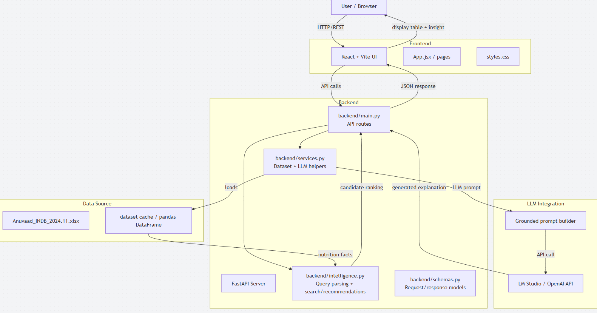

# NutriWise

NutriWise is a dataset-backed nutrition coaching application focused on practical food decisions, especially in an Indian meal context. It combines a FastAPI backend, a React/Vite frontend, a structured nutrition dataset, and optional LLM-powered explanations to help users move from vague food questions to actionable meal guidance.

Instead of acting like a generic chatbot, NutriWise builds a lightweight "nutrition twin" for each user and uses that profile to drive recommendations, meal repair suggestions, Indian cuisine-aware insights, food comparisons, and day-plan generation.

## What the project does

NutriWise supports a full coaching-style workflow:

- Create a profile with age, weight, height, gender, activity level, goals, restrictions, allergies, cuisine preferences, budget, and prep-time preferences.
- Estimate BMI, BMR, TDEE, and daily macro-oriented targets from that profile.
- Search foods from the local dataset using natural-language intent like "high protein vegetarian breakfast under 300 calories".
- Explain why a food is a good fit instead of only returning a ranked list.
- Break down a real meal, identify imbalances, and recommend practical fixes.
- Compare two foods side by side using the dataset values.
- Build a constraint-aware daily meal plan based on pantry items, budget, and time.
- Add an Indian meal lens that detects cuisine style and suggests more familiar, realistic swaps.
- Optionally use LM Studio or OpenAI to generate grounded natural-language explanations on top of dataset facts.

## Product surfaces

The frontend is organized into seven user-facing workspaces:

- `Nutrition Twin`: creates and stores a profile snapshot used by the recommendation engine.
- `Nutrition Explorer`: food lookup plus side-by-side comparison.
- `Intent Search`: query-by-goal discovery using terms like nutrient focus, meal type, or restrictions.
- `Meal Repair`: analyzes a described meal and suggests improvements.
- `Why This Food?`: personalized recommendations with explanation bullets.
- `Smart Planner`: builds a day plan around profile targets and constraints.
- `Indian Lens`: adds cuisine-aware interpretation and healthier swap suggestions for Indian meals.

## How it works


At a high level, NutriWise has two intelligence layers:

1. A deterministic recommendation and scoring layer built around the local nutrition dataset.
2. An optional language-model layer used only to turn structured nutrition facts into readable explanations.

The deterministic layer is the core of the app. It loads `Anuvaad_INDB_2024.11.xlsx`, derives searchable fields and heuristics, tags foods by category and cuisine, estimates nutrition density, and scores foods against user goals such as weight loss, muscle gain, diabetic-friendly eating, or heart health.

The LLM layer is used for tasks like:

- explaining the top food lookup matches
- comparing two foods in plain language
- handling the older generic `/query`, `/analyze`, `/meal-plan`, `/education`, and `/recommendations` flows

Those explanations are grounded with facts pulled from the dataset. If no model is available, NutriWise falls back to deterministic responses where possible.

## Tech stack

### Backend

- FastAPI for the API server
- Pydantic and `pydantic-settings` for request models and configuration
- Pandas for dataset loading and transformation
- Optional OpenAI client support
- Optional LM Studio local model support

### Frontend

- React 18
- Vite 5
- Plain CSS in `frontend/src/styles.css`

### Data / intelligence

- Local nutrition dataset: `Anuvaad_INDB_2024.11.xlsx`
- Heuristic profile scoring and recommendation engine in `backend/intelligence.py`
- Additional LLM/data processing hooks in `backend/services.py` and `llm_integration.py`

## Repository structure

```text
NutriWise/
|- backend/
|  |- main.py            # FastAPI routes
|  |- intelligence.py    # Profile engine, scoring, planning, Indian food logic
|  |- services.py        # LLM-backed query handling and grounded text generation
|  |- schemas.py         # Request/response models
|  |- config.py          # Environment-backed settings
|- frontend/
|  |- src/
|  |  |- App.jsx         # Main single-page interface
|  |  |- main.jsx        # React entry point
|  |  |- styles.css      # App styling
|  |- vite.config.js     # Dev proxy to FastAPI
|  |- package.json
|- app.py                # Local backend entry point
|- llm_integration.py    # Nutrition LLM integration utilities
|- recommendation_system.py
|- nlp_engine.py
|- datapreprocessor.py
|- requirements.txt
|- .env.example
|- Anuvaad_INDB_2024.11.xlsx
```

## Core backend capabilities

### 1. Personal nutrition twin

When a user profile is created, NutriWise computes:

- BMI and BMI category
- BMR
- TDEE using activity multipliers
- calorie target adjusted by goal
- daily protein, carb, fat, fiber, and water targets

It also stores user preferences such as:

- dietary restrictions
- allergies
- health conditions
- cuisine preferences
- budget preference
- maximum prep time

This profile becomes the shared context for recommendations and plan generation.

### 2. Food discovery and ranking

NutriWise loads the food dataset and enriches it with derived metadata such as:

- normalized search text
- calories and macros per serving
- inferred meal slots like breakfast/lunch/dinner/snacks
- inferred cuisine tags
- budget tier
- estimated prep time
- nutrition density score

The recommendation layer then scores foods by combining:

- direct text overlap with the query
- nutrient-specific bonuses
- goal-specific scoring rules
- meal-slot fit
- cuisine-preference fit
- pantry relevance
- budget and prep-time constraints

### 3. Meal repair

The meal repair flow extracts foods from a free-text meal description, totals calories/macros/fiber, checks macro balance, and suggests targeted fixes such as:

- adding a protein-rich item
- adding a fiber-rich item
- trimming a calorie-dense item
- improving glucose steadiness with better pairings

### 4. Smart planner

The planner turns profile targets into meal budgets across breakfast, lunch, dinner, and snacks, then picks foods that fit:

- the user profile
- the requested budget
- pantry items
- prep-time limits
- the planning query

### 5. Indian food intelligence

NutriWise includes specific cuisine heuristics for:

- South Indian meals
- North Indian meals
- street food
- beverages
- festival foods

This lets the app interpret meals more realistically and recommend swaps that still feel culturally familiar.

## API overview

Main active endpoints include:

- `GET /health`
- `GET /settings`
- `POST /profile`
- `GET /profile/{user_id}`
- `GET /history/{user_id}`
- `POST /discover`
- `POST /recommendations/personalized`
- `POST /meal-repair`
- `POST /smart-plan`
- `POST /indian-intelligence`
- `POST /food-lookup`
- `POST /food-compare`

There are also older generic query endpoints still present in the backend:

- `POST /query`
- `POST /analyze`
- `POST /meal-plan`
- `POST /education`
- `POST /recommendations`

## Running locally

### 1. Python backend setup

Create and activate a virtual environment, then install dependencies:

```powershell
python -m venv .venv
.\.python -m venv .venv
.\python -m venv .venv
.\venv\Scripts\Activate.ps1
pip install -r requirements.txt
```

Start the FastAPI server:

```powershell
python app.py
```

The backend runs on `http://127.0.0.1:8000`.

### 2. Frontend setup

From the `frontend` directory:

```powershell
npm install
npm run dev
```

The frontend runs on `http://localhost:5173`.

The Vite dev server proxies `/api/*` requests to `http://127.0.0.1:8000`, so local frontend/backend development works without changing the client code.

## Environment variables

NutriWise reads configuration from `.env`. A starter file exists at `.env.example`.

Supported settings in the current backend include:

```env
OPENAI_API_KEY=your_openai_api_key
APP_NAME=NutriWise API
APP_ENV=development
DEFAULT_USE_LMSTUDIO=true
LMSTUDIO_URL=http://localhost:1234/v1/chat/completions
LMSTUDIO_MODEL=openchat-3.6-8b-20240522
FRONTEND_ORIGIN=http://localhost:5173
DATASET_PATH=Anuvaad_INDB_2024.11.xlsx
```

Notes:

- `DEFAULT_USE_LMSTUDIO=true` means the UI defaults to local-model mode.
- `OPENAI_API_KEY` is optional unless you want OpenAI-backed explanations.
- `DATASET_PATH` should point to the nutrition file the backend will load on startup.

## LLM usage model

NutriWise is designed so that LLMs enhance the experience rather than define the whole product.

- Recommendations and scoring come from the dataset and local rules.
- LLMs are mainly used to produce natural-language explanations from grounded facts.
- If LM Studio is available, the app can use a local model endpoint.
- If OpenAI is configured, some explanation paths can fall back to `gpt-4o-mini`.
- If no model is available, some endpoints still return deterministic dataset-backed results.

This makes the app more reliable than a pure chat-only nutrition assistant and easier to debug.

## Current behavior and limitations

- User profiles and history are stored in memory, not in a database. Restarting the backend clears them.
- Food matching is heuristic and text-based, so unusual phrasing or misspellings may reduce quality.
- Several legacy modules remain in the repo from earlier iterations, while the main app experience now centers around `backend/` plus `frontend/src/App.jsx`.
- `requirements.txt` is broad and includes packages beyond the minimum currently needed for the FastAPI + React path.
- Nutrition guidance here is software logic based on a dataset, not medical advice.

## Why this project is interesting

NutriWise is stronger than a generic nutrition demo because it tries to solve a very practical problem: helping users make better food decisions without forcing them into unrealistic, culture-neutral meal suggestions.

The interesting parts are:

- profile-aware scoring instead of plain keyword search
- explainable recommendations instead of black-box ranking
- meal repair instead of only meal generation
- Indian meal interpretation instead of generic Westernized defaults
- optional LLM explanations layered on top of deterministic nutrition logic

## Suggested next improvements

If you want to keep evolving the project, the most valuable next steps would be:

- persist profiles and history in a real database
- add authentication and multi-user session management
- add automated tests for scoring, filtering, and API routes
- tighten and split `requirements.txt`
- improve fuzzy search and typo tolerance
- add serving-size normalization and portion editing in the UI
- add citations back to exact dataset rows used in each response
- containerize the stack with Docker

## License / usage

No license file is currently present in this repository. If you plan to share or publish the project, add an explicit license so usage terms are clear.
